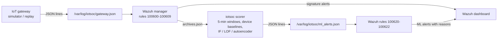

# IoT SOC Anomaly Lab

**Wazuh signature rules + behavioural anomaly detection for an IoT edge gateway, with labelled attacks so you can measure what each approach really catches.**

[](https://github.com/Salarsefat/iot-soc-anomaly-lab/actions/workflows/ci.yml)


A hands-on lab for SOC practitioners. A simulated smart building (20 IoT devices behind one gateway) streams MQTT, firewall-flow, DNS, login and firmware events into **Wazuh**. Seven attacks and three harmless-but-unusual events are scripted, and the ground truth is stored separately. You can then compare:

* **Signature rules** (Wazuh custom rules: brute force, wildcard MQTT subscription, unsigned firmware, internal scan)
* **Unsupervised detectors** (Isolation Forest, LOF, autoencoder) on **per-device behavioural baselines**
* **A hybrid policy** that sends both to the SOC, with severity for triage and a one-line explanation per alert

Everything runs offline in about a minute on a laptop. The same code also runs **live on a Wazuh server**: events go in through Wazuh, the scorer reads Wazuh's archive, and ML alerts come back into Wazuh as rules `100621`/`100622`.



---

## Quick start (offline, no Wazuh needed)

```bash
git clone https://github.com/Salarsefat/iot-soc-anomaly-lab.git
cd iot-soc-anomaly-lab
python -m venv .venv
source .venv/bin/activate          # Windows PowerShell: .venv\Scripts\Activate.ps1
pip install -r requirements-dev.txt
python -m iotsoc run --seeds 5     # ~2 minutes; one seed takes ~25 s
```

The `output/` folder then contains `report.html` (tables and figures), `results.md`, per-window scores, the attack-coverage table and `ml_alerts.json` (the exact lines Wazuh would ingest). To walk through it step by step, open `notebooks/walkthrough.ipynb`.

Run the tests with `python -m pytest -q`.

## Live on Wazuh (the workshop demo)

On an all-in-one Wazuh server (written for the Wazuh 4.x OVA):

```bash
curl -sL https://raw.githubusercontent.com/Salarsefat/iot-soc-anomaly-lab/main/wazuh/bootstrap.sh | sudo bash
sudo iotsoc demo                # 2 simulated hours in ~3 minutes
```

The installer adds the rules, the two log inputs, JSON archives, a Python environment and a trained model, and it can be undone with `wazuh/uninstall.sh`.

In the Wazuh dashboard, filter on `rule.groups:iotsoc`. Full steps, what to expect on screen, troubleshooting and the uninstall procedure are in **[docs/live-wazuh.md](docs/live-wazuh.md)**.

---

## The simulated building

| Devices | Normal behaviour | Management interface |
|---|---|---|
| 10 sensors `sens-01..10` | telemetry every 2 min, cloud sync every 15 min | none |
| 4 cameras `cam-01..04` | motion events, video to the NVR (~50 MB / 5 min), thumbnails to the cloud, rotating CDN | telnet (exposed: background scanner noise) |
| 3 smart locks `lock-01..03` | door events (busy in office hours), heartbeats | none |
| 3 HVAC controllers `hvac-01..03` | status every minute, BACnet to the BMS, occasional admin SSH + config change | SSH |

All addresses are reserved ranges (RFC 1918, RFC 5737 TEST-NETs, RFC 2544) and all domains use `.example`. No real infrastructure is touched.

**Timeline:** day 0 warm-up → days 1–3 training (normal only) → day 4 calibration (normal only, used to set thresholds) → day 5 test.

### Scripted incidents on the test day

| Scenario | Device | MITRE ATT&CK | Signature rule expected |
|---|---|---|---|
| Mirai-style telnet brute force, loader download, outbound scanning | cam-02 | T1110.001 | 100602 |
| Unsigned firmware from an attacker host | lock-02 | T1542.001 | 100606 |
| Low-and-slow SSH guessing (~15 attempts/hour for 4 h) | hvac-03 | T1110.001 | none |
| Broker account guessing, then wildcard MQTT subscriptions | sens-07 | T1110.001, T1040 (closest fit) | 100604 |
| Bulk HTTPS upload to an unknown host | cam-04 | T1048 | none |
| C2 beaconing every 60 s + DGA-style DNS lookups | sens-03 | T1071.001, T1568.002 | none |
| Internal service discovery | hvac-02 | T1046 | 100608 |
| *Benign:* vendor-signed firmware rollout on all cameras | cameras | – | 100605 (info) |
| *Benign:* technician SSH maintenance | hvac-01 | – | 100603 (info) |
| *Benign:* MQTT broker restart (every device reconnects) | all | – | none |

## How detection works

1. **Behaviour windows.** For each device and each 5-minute window: 20 counts and volumes (MQTT messages and bytes, connection failures, logins, internal and internet connections, bytes in and out, distinct destinations and ports, destinations and domains *not seen by this device in the last 24 h*, random-looking DNS labels, firmware updates, config changes). Three 1-hour rolling sums (failed logins, internet connections, new destinations) let low-and-slow activity add up. Idle windows are explicit zero rows.
2. **Self-baselines.** Each feature is compared with *the same device's* history at the same time of day (office hours vs night). Inside the device's normal range we use a robust z-score. Beyond it, distance grows by one unit per ×1.65. Many IoT counters are zero most of the time, so the scale takes the 1st–99th percentile spread into account, not just the median absolute deviation.
3. **Detectors.** Isolation Forest, LOF (novelty mode) and a small autoencoder are trained on the baselined training windows. As a comparison, an Isolation Forest is also trained on raw log-features with no baseline, which is the common "throw the features at an Isolation Forest" approach.
4. **Calibration.** Each threshold is the 99.8th percentile of that detector's scores on the separate calibration day (target: 0.2 % of windows). Labels are never used for fitting or for thresholds; they are joined after scoring.
5. **Alert policy sent to the SOC (hybrid).** Signature rules, **or** the autoencoder, **or** at least 2 of the 3 models agreeing. An alert is **high** severity when a second model or a signature rule agrees, and **medium** otherwise. Each alert carries the top deviating features in plain words, e.g. `bytes sent to the internet 29.9 MB (usual 0 B-39.5 kB)`.

## Results (synthetic data, 5 seeds)

Test day: 24 h, 20 devices, 5,760 device-windows, 7 attacks. Values are mean ± std over seeds 7–11 (`python -m iotsoc run --seeds 5`). "False incidents" are runs of consecutive alerted windows on one device that do not overlap an attack, a benign event, or the hour after one.

| Detector | Attacks found (of 7) | False incidents / day | PR-AUC |
|---|---|---|---|
| Signature rules (Wazuh-style) | 4.0 ± 0.0 | 0.0 ± 0.0 | – |
| Isolation Forest, raw features | 4.2 ± 0.4 | 10.0 ± 4.2 | 0.15 ± 0.02 |
| Isolation Forest + device baselines | 3.2 ± 0.8 | 12.2 ± 6.9 | 0.20 ± 0.02 |
| LOF + device baselines | 4.8 ± 0.4 | 10.6 ± 5.7 | 0.51 ± 0.06 |
| Autoencoder + device baselines | 7.0 ± 0.0 | 10.6 ± 4.2 | 0.63 ± 0.02 |
| Ensemble (2 of 3 agree) | 5.0 ± 0.0 | 1.2 ± 2.2 | 0.63 ± 0.01 |
| **Hybrid (what the SOC receives)** | **7.0 ± 0.0** | **10.6 ± 4.2** | **0.66 ± 0.02** |

The per-attack time to detect, the benign-event table and the per-severity triage numbers are in `output/results.md` after a run, and in [docs/results.md](docs/results.md).

**What the numbers say, and what they don't:**

* **Rules are precise but blind to the unknown.** Zero false alarms, and they catch the loud, well-understood attacks (brute force, wildcard subscription, unsigned firmware, scan). They miss exfiltration, C2 beaconing and low-and-slow guessing.
* **The algorithm you pick is not a detail.** The Isolation Forest is the weakest model here, with or without baselines. A likely reason (not tested here) is that it splits on randomly chosen features, so a spike in one or two of the 23 features gets diluted. The autoencoder on the same baselined features found all 7 attacks in every seed.
* **Severity is the triage lever.** In the seed-7 run, *high* alerts (models agree) produced no false incidents. Almost all of the ~10 false incidents per day were *medium*.
* **Benign change looks like an attack.** The firmware rollout was flagged on all 4 cameras, and the broker restart on all 20 devices by the autoencoder. An analyst needs change-management context, and fleet-wide events should be grouped into one incident.
* **About 10 false incidents per day for 20 devices does not scale to 2,000 devices.** Alert budgets, per-fleet aggregation and suppression are design problems, not afterthoughts.
* **Caveats.** The same author wrote the simulator and the detectors, and the hybrid policy (autoencoder as primary) was chosen after seeing these synthetic results. This is a teaching lab, not evidence that the method works in production. Validate on your own telemetry with an independent attack schedule before drawing conclusions.

## Repository layout

```
iotsoc/            Python package
  simulate.py      device fleet behaviour, attacks, benign events, ground truth
  features.py      5-minute windows, novelty memory, rolling sums, device baselines, explanations
  detectors.py     signature-rule mirror, IF / LOF / autoencoder, calibration, alert policy
  pipeline.py      training bundle, scoring, Wazuh alert export
  evaluate.py      window, incident, time-to-detect and triage metrics
  live.py          event-time windowing with a watermark, tail -F of archives.json, replay
  report.py        self-contained HTML report
  cli.py           python -m iotsoc run | train | replay | live | demo | samples
wazuh/             rules, install / uninstall, wazuh-logtest checks
docs/              live-Wazuh guide, workshop plan and exercises, method notes, results
notebooks/         step-by-step walkthrough
tests/             unit tests, including "live scorer == batch scorer"
```

## Limitations

* Synthetic telemetry from one gateway. Real IoT fleets are messier: clock skew, gaps, firmware diversity, NAT.
* Python uses 5-minute tumbling windows. Wazuh frequency rules use sliding time frames, so the Python rule mirror is an approximation.
* No concept drift handling: baselines are fixed at training time. Retraining, drift checks and telemetry-health monitoring are left as exercises.
* The live scorer is a single process for a lab, not a hardened service.

## Credits

The idea came from [jko999/wazuh-ai-soc](https://github.com/jko999/wazuh-ai-soc), which applies an Isolation Forest to per-event Wazuh features. This repository is an independent implementation: it uses no code, data or screenshots from that project. Its "Isolation Forest, raw features" row is only a loose stand-in for that style of approach (window features rather than per-event features), not a reproduction of it.

Author: **Salar Sefati**. Released under the [MIT License](LICENSE). Not affiliated with or endorsed by Wazuh, Inc.
